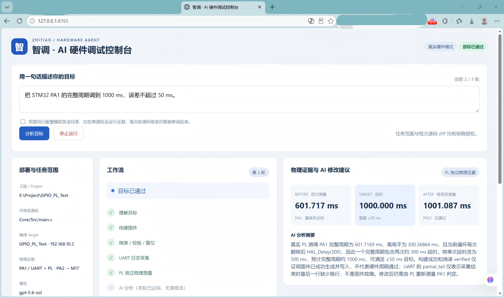

# 智调盒——AI上板摆渡站

· [嵌赛官网提交的正式技术文档PDF](report/design_report.pdf) ·

智调读 tiáo / ZHITIAO，是一个基于 FPGA UART 监测 + PL 独立物理反馈的 MCU LLM 闭环调试系统。

报名方向：**AMD-自主选题（初级）**。报名所选平台类别覆盖AMD 7 Series／Zynq-7000／UltraScale系列，实际使用ALINX AX7Z020（xc7z020clg400-2），以STM32G431RBT6为目标板例。报名简介及已验证范围见[项目介绍](report/project_overview.md)。

面向AI辅助硬件开发的“最后一米”：通过网络连接PC Agent，以USB／SWD完成烧录与复位，以UART和PL采集真实反馈。研发调试、远程协作、FAE支持与共享实验室是应用方向，当前实证是STM32 GPIO周期调节。

智调盒并非单纯的自动下载器，而是让 AI 真正进入真实硬件调试闭环：反复构建与烧录的是 STM32 等目标 MCU 工程；Zynq/FPGA 作为长期驻留的执行与物理观测基础设施，在初始化后不随每轮任务反复烧录。

自然语言目标 → Agent → 确定性 Controller → build / flash / UART / PL → FAIL 证据 → AI diff → 人工批准 → 重建验证 → PASS。

## 当前结果与发布范围

最终真实四接口两轮 run_5d8e004954664f6c8f8ff0f85d31959b：**601.7169 ms FAIL → HAL_Delay 300 改为 500 → 1001.08682 ms PASS**，目标完整周期 1000±50 ms。两轮均有四工具、fresh_edges=2；第一轮 partial_tail=true、truncated=false，未阻止 PL。

原始最终报告、发布main.c与第二轮HEX已做SHA一致性核对。主证据现采用最后上传的网页导出JSON的脱敏副本；与此前归档是同一次run，仅导出总耗时相差约0.02秒，不是新增实测。见[公开JSON](data/final_run_sanitized.json)、[测量表](data/measurements.csv)、[证据说明](report/test_evidence.md)及[来源清单](data/report_sources.json)。



原图显示三位小数，与JSON原精度一致；四张原图及场景说明见[截图索引](data/screenshots/readme.md)。其中1000.192ms单轮图明确跳过UART，单独作为PL-only参考，不计入完整四接口闭环。

**已整理Agent、STM32、网页JSON／四张实测截图／最终HEX，以及FPGA RTL／BD／XDC／工程、v5 bit和baseline/final原始实现报告。** 另已加入Zynq测试包中带许可的OpenOCD／libusb源码、构建入口及板端文件检查。含私钥的镜像和来源不完整的二进制不原样发布。FPGA四项外部IP仍按依赖交付。Linux按实际完成的“ALINX预构建镜像→rootfs网络定制→FIT重封装→SD部署”路线交付，已有[可执行复现方法](build/linux/readme.md)和[冷启动验证步骤](board/zynq/sd_deployment.md)，不声称从源码重建整套Linux。队伍报告已完成原系统冷启动链路验证。原件与公开位置见[材料索引](report/material_index.md)及[发布状态](report/release_status.md)。

v5 SHA 与指导一致。原 final 报告 LUT 7274、FF 12083、BRAM 20.5、DSP 0、IOB 44，WNS 0.709 ns、TNS 0。报告仍含未约束路径等 HIGH 警告，[原件与比较](report/fpga_evidence.md) 保留这些限制。

## FPGA 的作用与架构

Zynq-7000 AX7Z020 的 PL 以 100 MHz 独立测量完整周期／高电平，结合边沿 freshness 与一致性检查，避免软件自报周期代替实测；AXI Uartlite 采集 UART，AXI GPIO 表示工具进度。PC 负责 LLM、审批、Keil、SSH/SCP 与界面；PS 提供寄存器访问及 OpenOCD/ST-Link 通道。

FPGA 丰富、可编程且可扩展的物理接口，使 PL 不只是通信桥，而能够独立测量 GPIO 等真实硬件信号，为 AI 提供目标程序自身之外的物理证据。


四个公开工具保持 contract_version=0.2；PASS 由 PL 数值与容差决定，AI 无审批权和任意命令入口。

## 复现步骤

本仓库提供从源码、板端环境到真实硬件闭环运行的复现材料。建议首次复现按以下顺序进行；更完整的环境说明、失败边界与逐项检查见 [`report/reproduction.md`](report/reproduction.md)。

### 1. 准备环境与硬件

本项目当前验证平台为：

* PC：Windows，Python 3.13，Keil MDK；
* FPGA/SoC：ALINX AX7Z020，器件 `xc7z020clg400-2`；
* 目标 MCU：STM32G431RBT6；
* 调试器：ST-Link/V2，SWD；
* Zynq 板端：PetaLinux 2017.4 / Linux 4.9.0-xilinx / BusyBox 1.24.1。

FPGA 完整重建依赖合法安装的 Vivado 2017.4 及与 ALINX AX7Z020 参考工程匹配的四项外部 IP；其 VLNV、文件 SHA 与校验入口见 [`data/fpga_external_ips.json`](data/fpga_external_ips.json) 和 [`src/fpga/readme.md`](src/fpga/readme.md)。

如果只复现已经验证的最终闭环，不要求首先重新综合 FPGA；仓库已提供最终 v5 bitstream，PL 可在 Linux 启动后按板端初始化步骤加载。

### 2. 完成硬件连接

按照 [`board/wiring.md`](board/wiring.md) 完成连接。

当前验证接线包括：

* STM32 PA1 → Zynq M18：GPIO 周期与高电平测量；
* STM32 PA2 / USART2_TX → Zynq M17：UART，115200 8N1；
* Zynq USB Host → ST-Link/V2 → STM32 SWD：目标 MCU 烧录、校验与复位；
* PC ↔ Zynq：以太网通信。

其中反复构建和烧录的是 STM32 等目标 MCU 的固件；Zynq/FPGA 在初始化完成后作为执行与物理观测基础设施，不随每轮调试任务反复烧录。

### 3. 初始化 Zynq 与 FPGA PL

首先按照 [`board/zynq/pl_preparation.md`](board/zynq/pl_preparation.md) 完成板端准备，包括：

* 检查网络和 SSH；
* 检查 ST-Link USB 枚举；
* 校验 v5 bitstream SHA；
* 将最终 PL bitstream 加载到 `/dev/xdevcfg`；
* 检查 PL 寄存器与板端工具状态。

最终位流及相关构建材料见 [`build/fpga`](build/fpga/readme.md)。

当前 PL 在 100 MHz 时钟下完成 GPIO 周期/高电平测量，并通过 AXI UART Lite 获取目标 MCU UART 数据。PL 提供独立于目标固件自报信息的物理观测证据。

### 4. 配置并验证 Agent

进入 Agent 目录：

```powershell
cd src/agent
$env:PYTHONPATH = (Resolve-Path .\src).Path
py -3.13 -B -m unittest discover -s tests -v
```

复制部署配置：

```text
deployment.example.json
        ↓
deployment.local.json
```

并根据本机实际环境填写 Keil 工程路径、目标固件路径、Zynq 地址及板端工具路径。

`deployment.local.json` 属于本机私有配置，不应提交到仓库。

### 5. 启动系统

可根据验证目的选择：

```text
start_demo.bat
```

用于离线脚本模型 + 模拟硬件；

```text
start_ai_mock.bat
```

用于真实模型 + 模拟硬件；

```text
start_ui.bat
```

用于真实部署与硬件闭环。

真实模型调用需要在进程环境中提供 API Key；请勿将 Key 写入仓库或提交记录。

### 6. 执行真实闭环任务

在真实部署模式下输入自然语言调试目标，例如：

```text
把 STM32 PA1 的完整周期调到 1000 ms，误差不超过 50 ms。
```

系统按照以下顺序执行：

```text
自然语言目标
    ↓
Agent 分析
    ↓
Controller
    ↓
build_firmware
    ↓
flash_firmware
    ↓
read_target_log
    ↓
run_hardware_test
    ↓
FAIL → AI 提出 diff → 人工批准 → 下一轮
    ↓
PASS / 停止条件
```

新的源码 diff 必须经过人工批准；构建、烧录等工具成功不代表目标已经达成，最终 PASS / FAIL 由确定性硬件测试规则产生。

### 7. 对照已验证结果

仓库中的黄金闭环记录为：

```text
目标：1000 ± 50 ms

Round 1
PL period = 601.7169 ms
HAL_Delay = 300 ms
Result = FAIL

AI proposal
HAL_Delay(300) → HAL_Delay(500)

Round 2
PL period = 1001.08682 ms
Absolute error = 1.08682 ms
Result = PASS
```

复现后可与以下公开证据进行交叉核验：

* [`data/final_run_sanitized.json`](data/final_run_sanitized.json)：完整两轮执行记录；
* [`data/measurements.csv`](data/measurements.csv)：物理测量结果；
* [`report/test_evidence.md`](report/test_evidence.md)：证据与判定口径；
* [`report/llm_collaboration.md`](report/llm_collaboration.md)：代表性大模型协作过程；
* [`report/reproduction.md`](report/reproduction.md)：完整复现说明。

> **复现成功的核心判据不是界面启动或烧录成功，而是目标 MCU 经重新构建、烧录后，由 FPGA PL 获得新的物理证据，并由确定性测试规则得到预期 PASS / FAIL。**

## 硬件与连接

AX7Z020（Zynq-7000）＋STM32G431＋ST-Link/V2。PA1→M18 为周期观测；PA2/USART2_TX→M17，115200 8N1。GPIO 0x43C60000 bit0–3 为 active-low 四灯；J14/K14/J18/H18 已与最终 XDC 核对。详见 [接线](board/wiring.md)。

## 测试代码（Keil工程）

原合集`Project`目录映射到本仓库`src/stm32`，两份工程并列保留：

| 说明/合集名称 | 仓库位置 | 用途 |
| --- | --- | --- |
| GPIO_PL_Test | [原工程](src/stm32/gpio_pl_test) | 已有两轮四接口JSON及黄金HEX对应的工程 |
| GPIO_PL_Test_LED | [LED同步工程](src/stm32/gpio_pl_test_led/readme.md) | DK117E-G4板上八个用户LED随PA1方波同步亮灭，无需新增外接显示器件 |

**LED工程实测验证时，文件夹原名也是`GPIO_PL_Test`。** 为符合AMD指南的新增路径英文小写要求，发布目录使用`gpio_pl_test_led`，内部Keil Target仍为`GPIO_PL_Test`。本次上传的实际源码保持`HAL_Delay(500)`；旧说明中的300 ms基线未沿用。原工程和实测证据不变，新变体单独构建、记录验证结果；完整来源见[LED文件清单](data/stm32_led_manifest.json)。

LED 同步工程作为独立辅助演示变体发布，保留独立源码及离线/主机替身验证；黄金主实验的 JSON 与 HEX 不作为该变体的新真机证据。

## AMD 推荐目录对照

| 推荐项 | 本仓库 |
| --- | --- |
| src | src/agent、src/stm32下原版与LED同步版Keil工程、src/fpga/zhidiao_measure、src/third_party/openocd源码与许可 |
| sim | 软件/板端发布检查、计数核 RTL 仿真、构建控制流与匿名历史 smoke |
| build | STM32入口/HEX；FPGA Tcl/v5 bit／原报告；OpenOCD构建入口 |
| board | 接线、部署与冷启动说明 |
| data | 匿名报告、测量 CSV、校验清单 |
| skill | 按五类可复用能力组织，不要求原子化或固定数量 |
| report | 正式设计报告、LLM协作记录、完整复现说明与证据索引 |

按指南3.3.5.4，发布路径统一使用英文小写、数字、下划线或连字符（扩展名使用点号）；仅保留指南目录示例明确列出的根`README.md`与`skill/README.md`。其他说明文件为`readme.md`，根许可证为`license`。原STM32工程已同步改为`core/src/main.c`、`mdk-arm/gpio_pl_test.uvprojx`，内部Keil Target仍为`GPIO_PL_Test`。第三方许可证正文不变；历史JSON／diff中的原路径保留，映射与校验见[路径迁移说明](report/path_migration.md)。Python包名`zhidiao_agent`保持兼容。

## 已知边界

真实模型由 NiceCode API 提供，请求模型记录在报告中；LLM 集成上板，但暂未实现本地 LLM/PYNQ。一次修改一个批准的现有 UTF-8 文件；UART 115200 8N1。原系统冷启动网络／SSH、USB及SWD链路已验证，免密公钥持久化和PL开机自动加载仍按每次上电的手动初始化步骤准备。LED 表示工具状态，不等于 DUT PASS。原计数 RTL 在复位时输入已高的首次结果有启动残段边界，须等待后续稳定周期；见 [FPGA 说明](src/fpga/readme.md)。

## 文档与许可

[Skill 索引](skill/README.md) · [正式设计技术文档PDF](report/design_report.pdf) · [LLM协作记录](report/llm_collaboration.md) · [完整复现说明](report/reproduction.md) · [优化与失败分析](report/optimization_notes.md) · [验证总结](data/test_summary.md)。src/agent/docs 中日期文档为开发历史，不替代当前状态。

[Zynq测试包核对](report/zynq_intake.md) · [OpenOCD构建](build/openocd/readme.md) · [PL加载与检查](board/zynq/pl_preparation.md)。已确认fixed镜像有静态IP配置，但未把配置存在当作冷启动已验收；内嵌SSH主机私钥的镜像不公开。

原创内容采用 [MIT](license)，第三方范围见 [third_party_notices.md](third_party_notices.md)。

## 我们想说的话

**希望“智调盒——AI 上板摆渡站”这个项目的尝试，哪怕只是很小的一步，也能够触碰到嵌入式开发新范式的一角。**

**也感谢每一位愿意看到这里、愿意了解这个想法的人。希望这个尚不完美、却真实运行在硬件上的作品，能够让您看到我们所期待的那种可能。**
