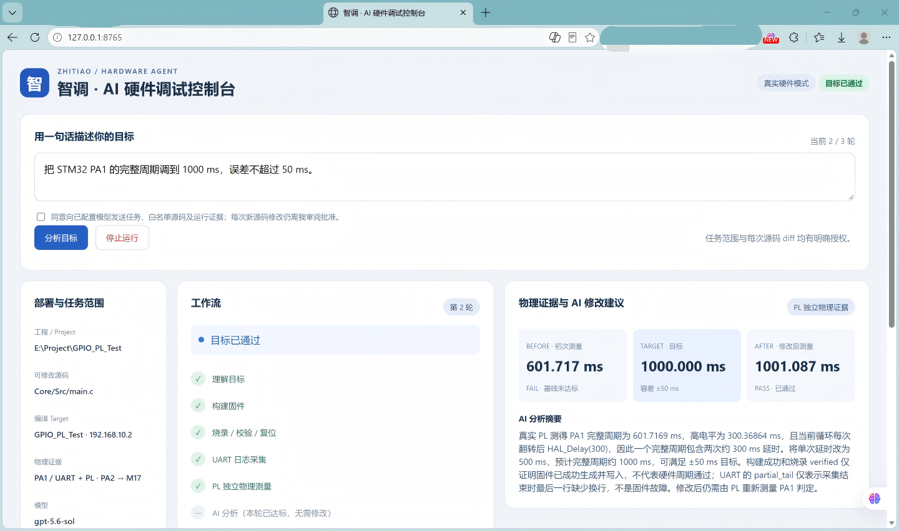
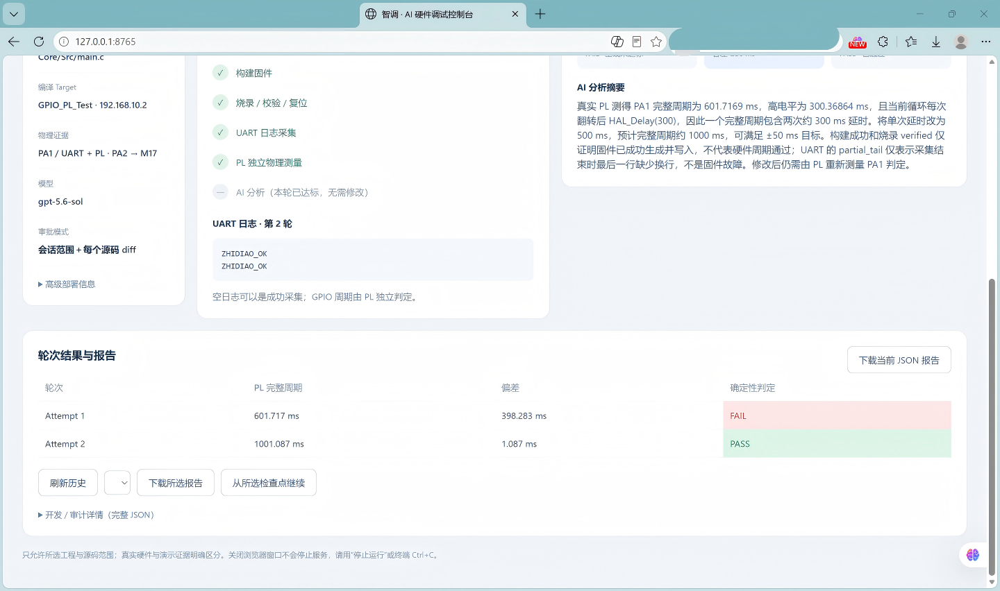
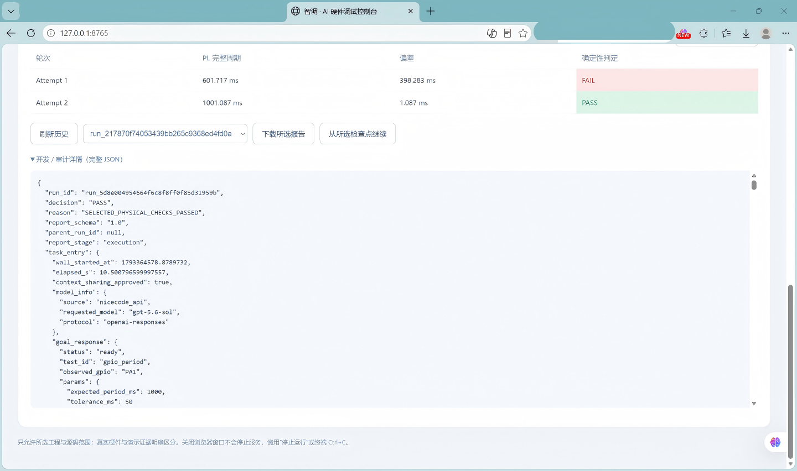
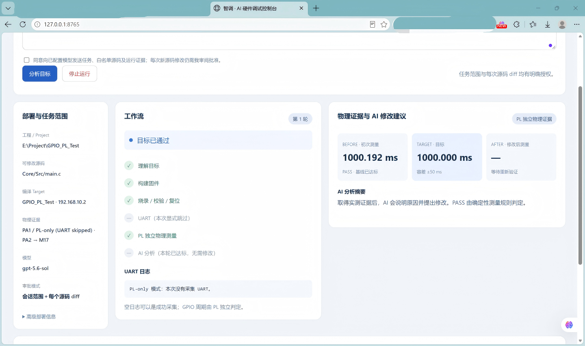

# 实测网页截图索引

来源：用户提供的photos.zip，共4张1440×852 PNG。按原字节改名归档，没有重绘、改数值、裁剪或重新压缩；图片中原有的浏览器遮挡保持原样。原ZIP、成员名、字节数与SHA见[来源清单](../report_sources.json)。报名介绍页的原图不在该ZIP内，其文字按对话截图转录至[项目介绍](../../report/project_overview.md)。这些是网页实测截图，不是板卡／接线实物照片。

数值关联经过人工读图核对，脚本检查文件SHA与说明中的数值关系，不进行OCR或硬件身份认证。主案例只有**一次运行、两轮attempt**；多张截图和两个JSON快照不增加运行次数。

## 主案例：四接口 FAIL → 源码修改 → PASS

关联run_id：`run_5d8e004954664f6c8f8ff0f85d31959b`。主证据为[网页导出的公开JSON](../final_run_sanitized.json)，不是用截图重建的报告。

图1：photos/1.png → ui_four_tool_pass.png。可见真实硬件模式、第二轮、UART与PL均执行完成，初始601.717ms、目标1000.000ms、修改后1001.087ms。JSON保留原精度601.7169／1001.08682ms；网页显示三位小数，二者一致。

图2：photos/3.png → ui_uart_results.png。第二轮收到两条ZHIDIAO_OK，轮次表显示第一轮FAIL、第二轮PASS；误差分别显示398.283／1.087ms，原值为398.2831／1.08682ms。UART是采集证据，GPIO达标由PL独立测量决定。

图3：photos/4.png → ui_report_audit.png。展开JSON的run_id为上述主案例；历史下拉选择另一个run_217870f74053439bb265c9368ed4fd0a，用于下载／恢复所选历史记录，**不是当前JSON的身份**。这张图不提供另一次成功实测的完整报告。界面现已增加两种ID的分别标识和用途说明，历史原图仍保持不变。

## 补充场景：基线已达标，显式跳过UART

图4：photos/2.png → ui_pl_only_baseline.png。单轮基线1000.192ms，容差±50ms，UART明确跳过，AI无需提出源码修改。本次没有该场景的独立JSON或可读run_id，因此只归类为截图参考；不能将它并入主案例，也不能当成另一次完整四接口或FAIL→修改→PASS闭环。
