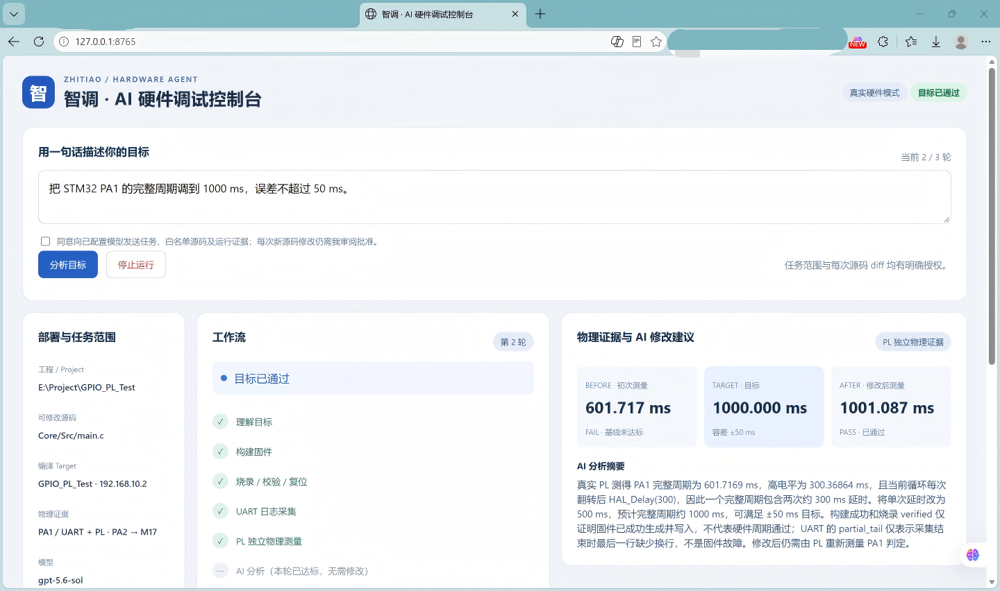
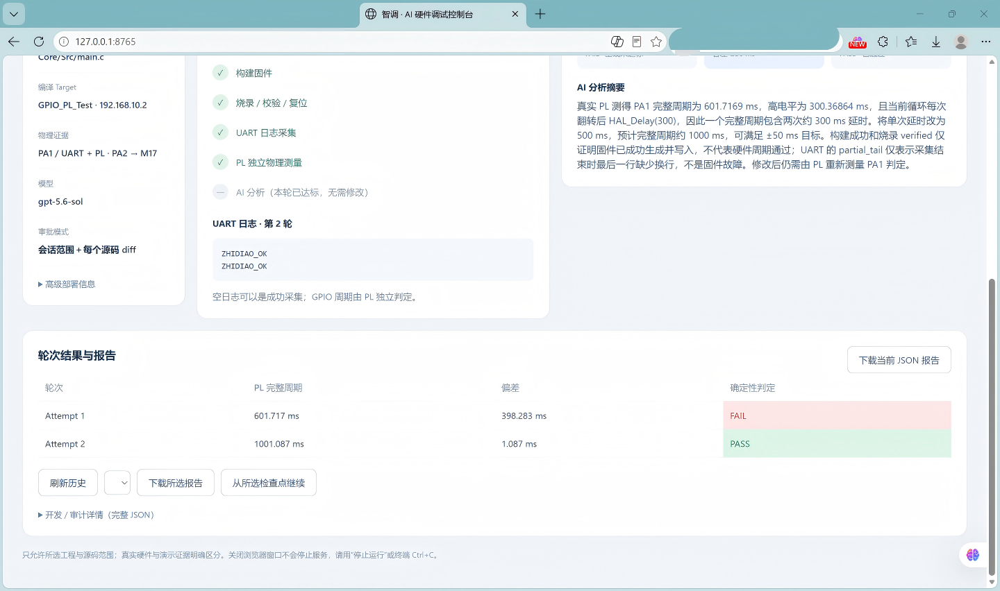
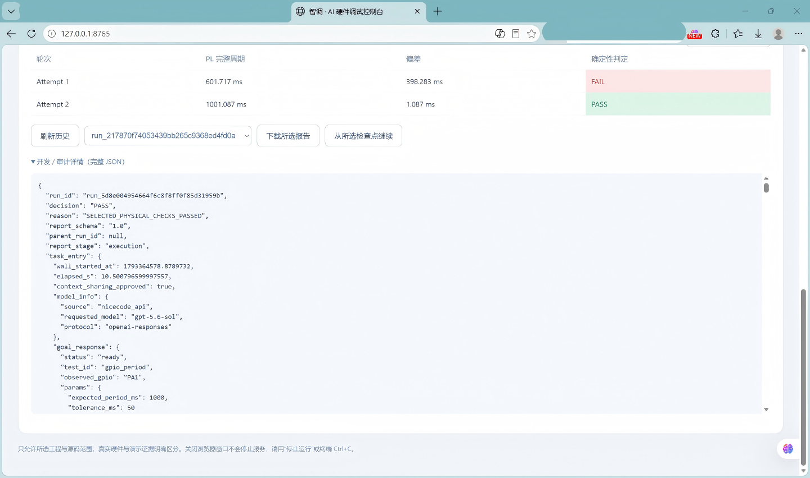
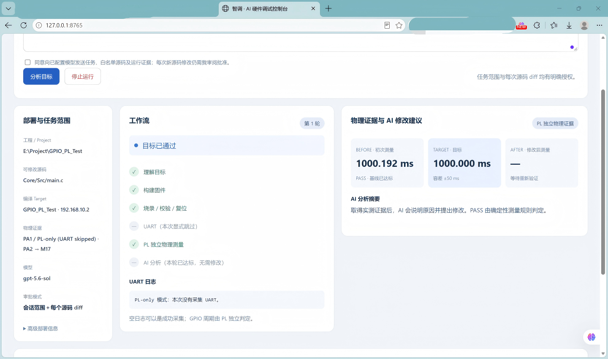

# 智调盒——AI上板摆渡站

本文件及同名 PDF 为已确认的官网提交版本。

厂商AMD，开发方向AMD-自主选题（初级），平台类别为AMD 7 Series FPGA／Zynq-7000 SoC／UltraScale／UltraScale+。实际实现使用ALINX AX7Z020（xc7z020clg400-2）和STM32G431，未证明其他类别平台已经适配。报名简介全文与边界见project_overview.md。

## 背景与创新

嵌入式代码修改需要跨越 PC 编译、远程部署、MCU 执行和物理测量。智调盒以独立 PL 证据组织可审计的 AI 调试闭环，避免仅凭模型或串口文字判断达标。适用范围当前为已配置 GPIO 的完整周期调节，不声称任意外设自动初始化。

项目面向AI辅助硬件开发的“最后一米”，通过网络连接PC Agent，经USB／SWD、UART与PL接口协调真实设备。研发调试、远程协作、FAE支持和共享实验室是应用方向，本次没有多租户服务或量化效率提升的测试数据。

## 原理与软硬件划分

用户任务 → PC Agent → Controller 安全边界 → Keil rebuild → SCP/SHA → Zynq OpenOCD/ST-Link → STM32 → UART/PL → 确定性判定 → AI 建议及人工批准。
PC 处理自然语言、源文件白名单、审批、预算和报告；PS 提供 SSH／寄存器与烧录服务；PL 实现100 MHz独立周期／高电平观测、freshness、UART与LED接口；STM32执行目标固件。

## 实现与接口

build_firmware(project_path)、flash_firmware(firmware_path)、read_target_log(duration_s)、run_hardware_test(test_id,params)，contract_version=0.2。
PA1→M18，PA2→M17，UART115200 8N1；数据地址和预算见board/wiring.md与部署示例。FPGA原创RTL、BD、导出Tcl、XDC、XPR、黄金v5位流及原始实现报告均已从四分包整理。LED约束与GPIO默认0xF已核对。

## 优化与验证

最终真实run两轮四工具：601.7169 ms FAIL，经HAL_Delay(300)→500，实测1001.08682 ms PASS，目标1000±50 ms；两轮新边沿2。第一轮正常UART半行没有阻断PL。源码、提案和HEX哈希已交叉核对，数据见data/。

| 轮次 | PL完整周期/ms | 误差/ms | UART与工具 | 确定性判定 |
| --- | ---: | ---: | --- | --- |
| 1 | 601.7169 | 398.2831 | 四接口均成功；UART有正常末行半行 | FAIL |
| 2 | 1001.08682 | 1.08682 | 四接口均成功；UART两条完整ZHIDIAO_OK | PASS |

主来源为最后上传的网页JSON，run_5d8e004954664f6c8f8ff0f85d31959b；与旧归档只有总elapsed_s相差约0.0199669秒，测量／工具／审批／源码一致。两种导出不是两次独立运行。网页展示三位小数601.717／1001.087ms，与JSON原精度一致，来源清单为data/report_sources.json。
原baseline→final：LUT6756→7274、FF10853→12083、BRAM20.5不变、DSP0、IOB38→44；整套设计增加观测／UART／LED开销，不是同功能资源压缩。WNS1.091→0.709ns，TNS均0；报告仍有942个未约束最大延迟pin、缺输入／输出时序约束等HIGH警告，不等于全设计时序覆盖完成。原件与解析表见report/fpga_evidence.md、data/fpga_metrics.csv。

Linux已实际运行Icarus RTL仿真，覆盖周期、高电平、边沿、新周期、sticky valid、复位和32位回绕。原件存在启动HIGH时首次值可能包含残段的边界，不能仅凭valid或两个新边沿保证所有启动相位安全；已保留说明，未改黄金RTL／位流。此测试不替代全BD仿真或板卡验证。软件验证见data/test_summary.md。

## LLM协作与Skill提炼

模型理解目标并根据证据提出单文件diff；Controller控制路径、顺序、最大尝试、超时、人工审批和停止。原始模型提案保留于匿名运行JSON，提示模板在Agent源码；完整HTTP对话尚未提供。

完整审阅diff见data/final_source_change.diff。除HAL_Delay(300)→500，还包含assert_failed文档注释“error line source number”→“line source number”；该无关注释变动如实保留，不能写成只改一行。本次不修改黄金源码或模型提示来重写历史。
Skill按闭环调试、可信PL、UART、部署和失败排查五类组织，各自注明来源、适用范围、使用和边界，不按固定文件数量拆分。

## 复现与限制

详见report/reproduction.md及build/fpga/readme.md。实际Vivado2017.4，与指南推荐新版存在差异；已提供重建Tcl，但Vivado／Keil重建未在云端执行。四项供应商IP因完整再分发许可未附，按VLNV／37文件SHA和合法获取步骤列为外部依赖；不能称为无外部依赖的一键构建。UART有限窗口与字节上限，单文件修改且需审批，依赖第三方API的可用性。

Zynq_Linux_Test两分包已核对，带许可的OpenOCD／libusb源码及构建入口公开，887份部署脚本与源码一致。fixed FIT与原件kernel／fdt相同，ramdisk增加静态IP和主机私钥等；私钥和含密钥镜像不公开，原ARM ELF因确切静态依赖来源不齐也不直接发布。Linux采用ALINX配套预构建镜像的rootfs定制路线，重封装步骤及SD部署已整理，不声称完整PetaLinux源码级重建。当前版本PetaLinux2017.4、Linux4.9.0-xilinx、BusyBox1.24.1；新HDF的内含bit和BD与黄金v5相同。v5在Linux启动后动态加载，无需重新生成BOOT.BIN。队伍报告原系统冷启动网络／SSH／USB／SWD链路已验；云端离线新产物尚未上板，authorized_keys持久化及PL自动加载仍单独记录，实物照片和正式报告按单独流程整理。

Agent已记录Linux Python3.13全量465项通过，本轮Agent未改；rootfs／HDF及根sim的实际检查结果以data/test_summary.md和data/linux_customization_verification.txt为准。此前实际完成OpenOCD Linux x86-64本机静态构建与0.12.0版本检查，构建中的libtool／Jim Tcl链接问题已修正；保留glibc NSS警告。这些软件结果不代表ARM交叉编译、Zynq／USB／SWD或烧录已经复验，详见data/test_summary.md及data/openocd_native_check.json。

## 实测截图与证据

以下4张为photos.zip的原PNG，文件未重绘／改数值／重新压缩；详细SHA与场景在data/report_sources.json及data/screenshots/readme.md。它们记录原界面版本，不是本次报告ID说明更新后重新执行的板卡测试，也不替代实物／接线照片。

